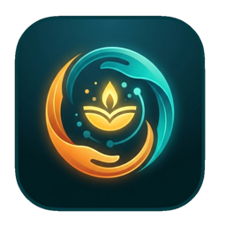
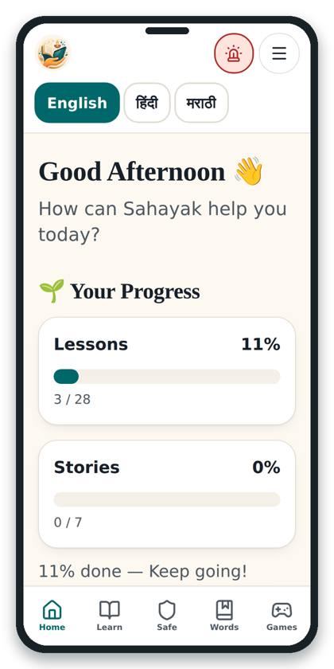
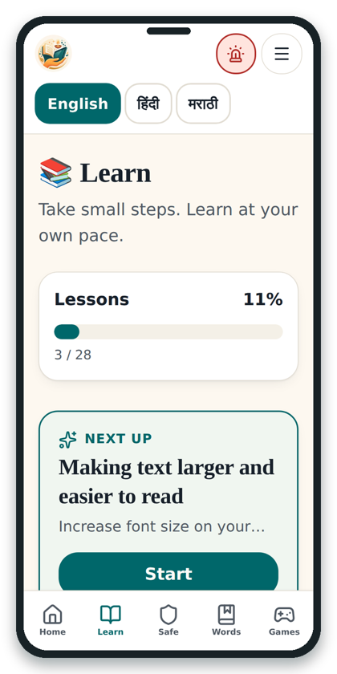
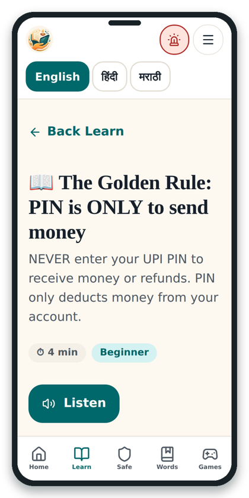
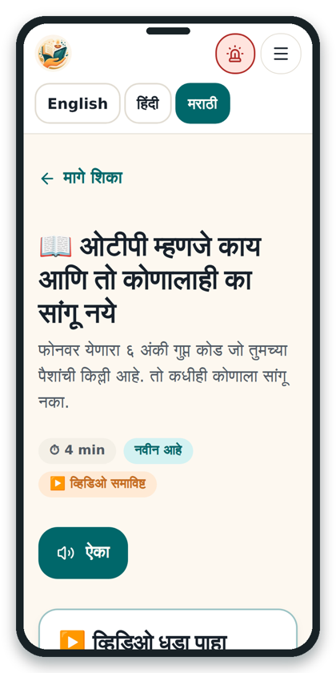
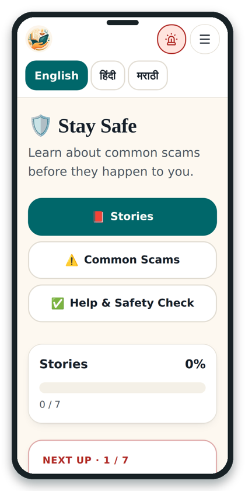
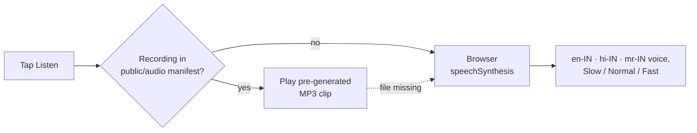
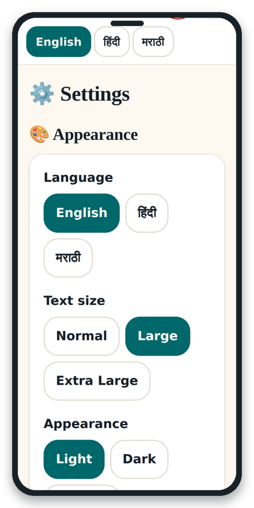
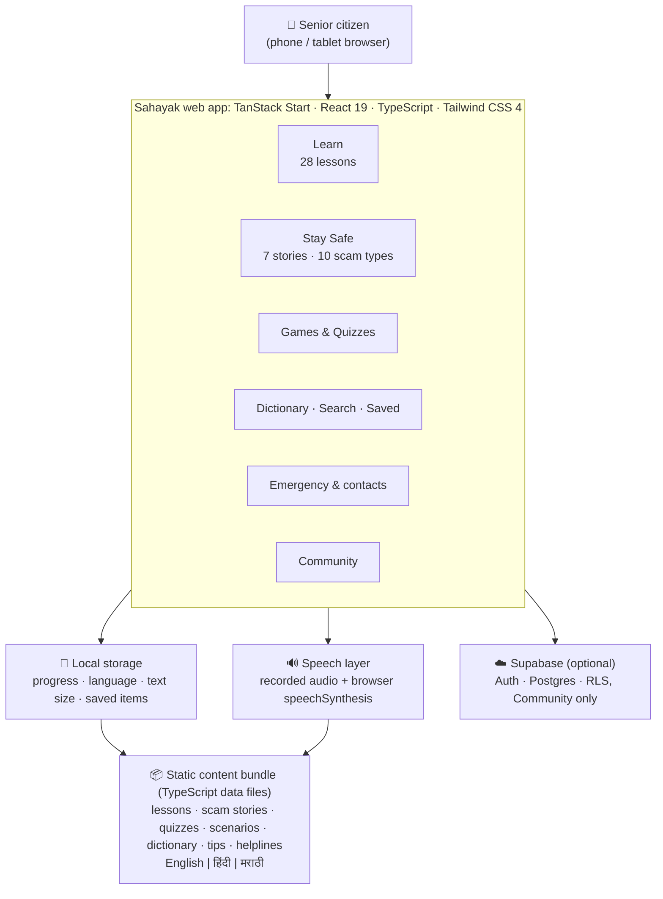

<div align="center">



# Sahayak · सहायक

### Learn. Stay Safe. Stay Connected.

**A digital-education and scam-safety web app built for elderly people in India: simple, multilingual, and made to be listened to.**

<p>
  
  
  
  
  
  
</p>
<p>
  
  
  
  
  
</p>

[**Why Sahayak**](#-why-sahayak) ·
[**Features**](#-features) ·
[**Screenshots**](#-screenshots) ·
[**Quick start**](#-quick-start) ·
[**Architecture**](#-architecture) ·
[**Project structure**](#-project-structure) ·
[**Team**](#-team)

<br/>







</div>

---

## 🌱 Why Sahayak

*Sahayak* means **"helper"** in Hindi and Marathi.

India's 60+ population grew from about **138 million in 2021** and is projected to reach about **194 million by 2031** ([NSO, *Elderly in India 2021*](https://theprint.in/india/indias-elderly-population-to-rise-41-over-next-decade-to-touch-194-mn-in-2031-govt-report/710476/)). Meanwhile, daily life keeps moving onto the phone: UPI alone processed about **24 billion payments in a single month** (September 2026, NPCI).

Most apps are built for younger users, so many elders face four barriers:

| | Barrier | What it looks like |
|---|---|---|
| 📱 | **Hard-to-use screens** | Small text, tiny buttons and long multi-step flows erode confidence. |
| 🔤 | **Language barrier** | English-heavy interfaces shut out Hindi- and Marathi-speaking users. |
| 👨‍👩‍👧 | **Dependence on family** | Payments, WhatsApp and online services need someone else's help. |
| 🛡️ | **Scam & fraud risk** | Fake KYC calls, UPI collect requests and "digital arrest" threats. |

> **The problem is not that elders cannot learn technology. It is that most technology is not designed around their needs.**

Sahayak flips that: *technology should adapt to the learner, not the learner to the technology.*

---

## ✨ Features

<table>
<tr>
<td width="33%" valign="top">

### 📚 Learn
**28 step-by-step lessons** in 5 topics:

- 📱 Smartphone Basics (8)
- 💬 WhatsApp & Family (5)
- 💳 Digital Payments (5)
- 🌐 Internet & Wi-Fi (5)
- 🏛️ Everyday Services (5)

Numbered steps, estimated time, difficulty level, a **"Next up"** suggestion, and a short video for 24 of the lessons.

</td>
<td width="33%" valign="top">

### 🛡️ Stay Safe
- **7 real-style scam stories**, each with warning signs and a key lesson
- **10 common scam types** explained simply
- **Help & Safety Check** for "what do I do now?" moments
- **Emergency page**: one-tap call to **1930** (cyber-fraud helpline) and **112**, plus saved trusted contacts

</td>
<td width="33%" valign="top">

### ♿ Made for elders
- **3 text sizes**, high contrast, light/dark theme, reduced motion
- Large tap targets and a calm, uncluttered layout
- **Listen button** on lessons & stories with Slow / Normal / Fast speed
- Pause & resume from the same spot
- Installable as a **PWA**

</td>
</tr>
</table>

<details>
<summary><b>🎮 Practice &amp; reinforce</b> (click to expand)</summary>

<br/>

| Feature | What's inside |
|---|---|
| **Quizzes** | 6 quizzes, **35 questions**: Payments & UPI Safety · Internet & OTP Safety · WhatsApp Confidence · Smartphone Basics · Spot the Scam · Everyday Services. Progress survives a refresh and the best score is remembered. |
| **Games** | 4 games: *Scam or Safe?*, *Digital Word Quiz*, *Quiz Challenge*, *Safety Check* |
| **Dictionary** | **50 plain-language terms** (OTP, UPI, KYC, browser…) with meanings and tips, each with a Listen button |
| **Video tutorials** | **27 YouTube tutorials** on the Watch page, also embedded in lessons |
| **Daily tip** | 12 rotating safety & usage tips on the home screen |
| **Saved & Search** | Bookmark favourite lessons and stories, search across all content |

</details>

<details>
<summary><b>🌐 Three languages, everywhere</b> (click to expand)</summary>

<br/>

All UI text and all learning content ship in **English, हिंदी and मराठी**. Switch any time from the header; the screen you're on simply changes language.

| English | हिंदी | मराठी |
|---|---|---|
| Smartphone Basics | स्मार्टफ़ोन की मूल बातें | स्मार्टफोनची मूलतत्त्वे |
| Digital Payments | डिजिटल भुगतान | डिजिटल पेमेंट |
| Stay Safe | सुरक्षित रहें | सुरक्षित राहा |

Speech uses `en-IN`, `hi-IN` and `mr-IN` voices, preferring clear neural voices where the device has them.

</details>

<details>
<summary><b>🔊 How "Listen" works</b> (click to expand)</summary>

<br/>



- Only **one** reader plays at a time, and pause/resume keeps your position.
- Optional neural recordings are generated with [`edge-tts`](https://github.com/rany2/edge-tts) via `scripts/generate-audio.mjs` (see [Audio](#-optional-pre-generated-audio)).
- `src/routes/api/tts.ts` is a deliberate stub for a future online TTS provider; nothing depends on it today.

</details>

<details>
<summary><b>👥 Community (optional, needs internet)</b> (click to expand)</summary>

<br/>

A friendly space for sharing experiences and asking questions, with categories, posts, comments, likes and reporting. It is the **only** part of the app that needs an account and Supabase; everything else works without login.

</details>

---

## 📸 Screenshots

<div align="center">

| Home | Learn | Lesson |
|:---:|:---:|:---:|
|  |  |  |
| **Same lesson in Marathi** | **Stay Safe** | **Settings** |
|  |  |  |

</div>

### 🧭 Suggested demo flow

`Home` › `Language` › `Learn` › `Lesson` › `Listen` › `Safety` › `Settings`

---

## 🚀 Quick start

**Requirements:** a recent Node.js and npm (or Bun).

```bash
# 1. Clone
git clone https://github.com/<your-username>/sahayak.git
cd sahayak

# 2. Install
npm install

# 3. Run
npm run dev
```

Open the local URL printed in the terminal. **No account or API key is needed** for learning, safety, games, dictionary or settings.

<details>
<summary><b>⚙️ Enable Community (Supabase)</b></summary>

<br/>

1. Create a free [Supabase](https://supabase.com) project.
2. Run [`supabase/schema.sql`](supabase/schema.sql) in the SQL editor. It creates `profiles`, `posts`, `comments`, `likes` and `reports`, with **row-level security** policies.
3. Add your credentials to a `.env` file in the project root:

   ```env
   VITE_SUPABASE_URL=https://<your-project>.supabase.co
   VITE_SUPABASE_ANON_KEY=<your-anon-public-key>
   ```

> ⚠️ Use only the **anon/public** key. Never put the service-role key in this file or in any `VITE_` variable.

If these are not set, the app still runs and Community is simply unavailable.

</details>

<details>
<summary><b>🔊 Optional: pre-generated audio</b></summary>

<br/>

```bash
pip install edge-tts
node scripts/generate-audio.mjs          # generate missing clips
node scripts/generate-audio.mjs --force  # regenerate everything
```

This writes MP3s to `public/audio/<lang>/<id>.mp3` using Microsoft neural voices (`en-IN-NeerjaNeural`, `hi-IN-SwaraNeural`, `mr-IN-AarohiNeural`), and lists them in `public/audio/manifest.json`. Anything not listed falls back to the browser voice.

</details>

### 📜 Scripts

| Command | What it does |
|---|---|
| `npm run dev` | Start the dev server |
| `npm run build` | Production build (Nitro, **Vercel** preset) |
| `npm run preview` | Preview the production build |
| `npm run lint` | Lint with ESLint |
| `npm run format` | Format with Prettier |

### ☁️ Deploy

The build targets **Vercel** (`nitro` preset in `vite.config.ts`). Import the repo in Vercel, add the two `VITE_SUPABASE_*` variables if you want Community, and deploy.

---

## 🏗️ Architecture



**Design decisions**

- 🔓 **Learning needs no login.** Everything except Community works without an account or a backend.
- 💾 **Privacy by default.** Progress, favourites, scores, language and saved contacts live in the browser's `localStorage` on the user's own device.
- 📦 **Content is bundled** as typed TypeScript data (`Localized` = `{ en, hi, mr }`), so a new lesson is just a new object, with no CMS and no API.
- 🔁 **Graceful fallback everywhere**: recorded audio → browser speech; Supabase missing → Community hidden, rest unaffected.

### 🧰 Tech stack

| Layer | Technology |
|---|---|
| Framework | [TanStack Start](https://tanstack.com/start) + [TanStack Router](https://tanstack.com/router) (file-based routes, SSR) |
| UI | React 19, TypeScript, Tailwind CSS 4, Radix UI / shadcn-style components, Lucide icons |
| State | React context + `localStorage` (`src/lib/store.tsx`) |
| Speech | Web Speech API + optional pre-generated Edge-TTS audio |
| Backend (optional) | Supabase: Auth, Postgres with RLS |
| Build / Deploy | Vite 8, Nitro (Vercel preset) |
| Tooling | ESLint, Prettier |

---

## 🗂️ Project structure

```text
sahayak/
├── public/
│   ├── assets/branding/        # logos
│   ├── audio/                  # manifest.json + <lang>/<id>.mp3 (optional)
│   └── manifest.webmanifest    # PWA manifest
├── scripts/
│   └── generate-audio.mjs      # Edge-TTS audio generator
├── supabase/
│   └── schema.sql              # Community tables + row-level security
└── src/
    ├── routes/                 # file-based routes
    │   ├── index.tsx           #   Home
    │   ├── learn.tsx · learn.$lessonId.tsx
    │   ├── safe.tsx · safe.index.tsx · safe.$storyId.tsx
    │   ├── games.tsx · dictionary.tsx · watch.tsx
    │   ├── emergency.tsx · community.tsx
    │   ├── search.tsx · saved.tsx · settings.tsx · credits.tsx
    │   └── api/tts.ts          #   optional TTS seam (stub)
    ├── components/             # AppShell, ListenButton, QuizPanel, VideoCard, elder-friendly UI…
    ├── data/                   # lessons · scams · content (quizzes, dictionary…) · tips
    └── lib/                    # i18n · store · speech · progress · supabase
```

<details>
<summary><b>➕ Adding content</b></summary>

<br/>

- **A lesson:** add an object to `LESSONS` in `src/data/lessons.ts` with `title`, `description` and `steps` in `en`, `hi` and `mr`.
- **A scam story:** add to `SCAM_STORIES` in `src/data/scams.ts`.
- **A quiz question:** add to `QUIZ_QUESTIONS` in `src/data/content.ts` (`answer` is the index of the correct option).
- **A dictionary term:** add to `DICTIONARY` in `src/data/content.ts`.
- **New UI text:** add the key to all three languages in `src/lib/i18n.ts`.

</details>

---

## 🧪 Testing focus

Navigation · Lessons · Language switching · Settings · Audio / text-to-speech · Responsive layouts · Interactive features · Accessibility behaviour.

## 🔭 Roadmap

> Not implemented yet. Planned for future versions.

- [ ] More regional languages
- [ ] Full offline mode (service worker) and bundled recorded audio
- [ ] Voice-first interaction
- [ ] AI-powered digital assistant
- [ ] Caregiver / family mode
- [ ] Personalised learning paths
- [ ] Pilot with senior citizens at community centres

---

## 👥 Team

Built as a **Community Engagement Project (CEP)** at **PICT, Department of Computer Engineering**.

| Name | Roll no. |
|---|---|
| Soham Sunil Bhosale | 21106 |
| Vedant Hambirrao Desai | 21114 |
| Rohit Balaji Gaikwad | 21120 |

**Under the guidance of** Dr. A. M. Bagade, HOD  
**Faculty mentor:** Prof. Rutuja Kulkarni

---

<div align="center">

**Made with ❤️ at PICT**

*Learn. Practice. Use. Stay Safe.*

If Sahayak helps someone you know, give it a ⭐

</div>
